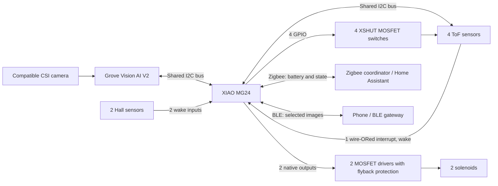
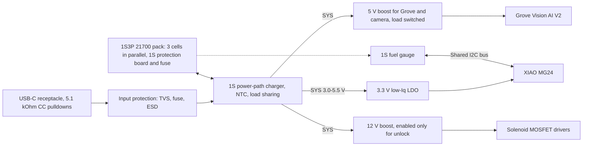

# Cat Flap

## Actuation

- [2 HS-0530B push-pull solenoids](https://www.amazon.de/dp/B0GVN9KNLD) — 12 V DC; 1.7 A; 20.4 W; 0.5 N initial force; up to 5 N holding force; 5% duty cycle; 58.2 mm overall length along the plunger's push/pull axis x 15 mm body width x 13.4 mm body height; 10 mm plunger stroke.

## Sensing

- [4 GERUI VL53L0X time-of-flight distance sensor modules](https://www.amazon.de/dp/B0DY7RMFML) — 940 nm infrared laser; I2C (TWI) interface; 50 ms response time; PWM output.
- [2 TI DRV5032AJLPGM Hall-effect switches](https://www.digikey.dk/da/products/detail/texas-instruments/DRV5032AJLPGM/12165184) — omnipolar, open-drain digital switches in TO-92; 1.65-5.5 V supply; about 1-4 µA; 9.5 mT maximum operate point (the least sensitive DRV5032 version). Replaces the A3144, which needs 4.5 V or more and draws about 4.4 mA.

## Support and Linkage

- [Bearing kit](https://www.amazon.de/dp/B0DQNGRL3R) — 60 pcs, 10 each of 693ZZ (3×8×4 mm), 623ZZ (3×10×4), 624ZZ (4×13×5), 685ZZ (5×11×5), 687ZZ (7×14×5), 627ZZ (7×22×7); carbon steel, double shielded.
- [300-piece compression spring assortment](https://www.amazon.de/dp/B0G19PLCMG) — 304 stainless steel; 23 sizes; wire diameter 0.3-0.7 mm; outer diameter 4-7 mm; length 10-30 mm.
- [12 stainless-steel rods](https://www.amazon.de/dp/B0DCBCRB1C) — 304 stainless steel; 3 mm diameter; 300 mm length each.
- [20 QUARKZMAN cylinder pins](https://www.amazon.de/dp/B0DS53LDKH) — 316L stainless steel; 4 mm diameter; 20 mm length; tapered ends.
- [HERCULES braided PE fishing line](https://www.amazon.de/dp/B076FKDWPD) — 300 m; 4-strand braid; PE/UHMWPE; selected diameter: 0.55 mm. Breaking strength varies by variant.
- [NeoDymium Magnets](https://www.amazon.de/Strong-Neodymium-Cylinder-Magnets-Silver/dp/B0DFCFDWPK/ref=sr_1_1_sspa?sr=8-1-spons&aref=JXHJv6yWv3&sp_csd=d2lkZ2V0TmFtZT1zcF9hdGY) — 4mm x 9mm small cylindrical Neodymium magnets.

## Compute and AI Vision

Selected architecture:

- [Grove Vision AI Module V2](https://www.seeedstudio.com/Grove-Vision-AI-Module-V2-p-5851.html): camera processing and local prey detection using its Cortex-M55/Ethos-U55 NPU; requires a [compatible CSI camera](https://wiki.seeedstudio.com/Grove-vision-ai-v2-camera-supported/).
- [XIAO MG24](https://www.seeedstudio.com/Seeed-Studio-XIAO-MG24-p-6247.html): Zigbee sleepy end device for battery and state reporting and BLE for images; no Wi-Fi. It reads four ToFs, two Hall inputs and two independent solenoid commands, and sleeps (EM2) until a Hall or ToF interrupt wakes it. No GPIO expander is assumed. The XIAO ESP32-C6 was the alternative with Wi-Fi; the MG24 was chosen for its lower sleep and radio currents (RX/TX about 5 mA) and BLE for images.

Target: decide within 1 second before unlocking, ideally using 5-10 fresh images. Keep microSD writes outside the decision burst. Images and predictions for labeling and retraining on our cats stay on the Grove module's microSD card, and selected images are sent over BLE to a nearby receiver (phone or always-on gateway) after the visit; the [SSCMA API](https://github.com/Seeed-Studio/SSCMA-Micro/blob/dev/docs/protocol/at_protocol.md) documents image replies and a `save_jpeg()` microSD action. Zigbee is too slow for images (a few kB/s shared with the mesh), so it carries only battery, state and detection metadata. Check the bandwidth of the Grove-to-MCU link (I2C is about 40 kB/s at best).

### Wiring and Pinout

Conceptual wiring, not a finalized electrical schematic. Camera connects to Grove, not the MG24. Grove (normally `0x62`) and all ToFs share the controller's I2C bus.

Allocation based on the [XIAO MG24 pin map](https://wiki.seeedstudio.com/xiao_mg24_getting_started/#pin-map); D labels and port pins are different.

| Signal | MG24 board pin | Port pin |
| --- | --- | --- |
| Front Hall input (wake) | D0 | PC00 |
| Tunnel-side Hall input (wake) | D2 | PC02 |
| ToF interrupt, wire-ORed (wake) | D3 | PC03 |
| Shared I2C SDA | D4 | PC04 |
| Shared I2C SCL | D5 | PC05 |
| Left solenoid command | D6 | PC06 |
| Right solenoid command | D7 | PC07 |
| Outward left ToF shutdown switch | D8 | PA03 |
| Outward right ToF shutdown switch | D9 | PA04 |
| Inward left ToF shutdown switch | D10 | PA05 |
| Inward right ToF shutdown switch | D13 | PB02 |
| Spare | D14, D18 | PB03, PD02 |
| Keep free (escape pin) | D1 | PC01 |

Avoid D11/D12 (the board's USB-serial chip) and D15-D17 (shared with the on-board flash). D1 (PC01) is the board's escape pin: if it is low during reset the device stops in an infinite loop, so do not put an active-low Hall output or other signal that can be low at reset on it. Two D pins (D14, D18) are spare, for example for an ADC divider or an interrupt. The ToFs range autonomously and raise the interrupt; the MG24 reads their status over I2C after waking. Use EM2 sleep (RAM retained) and verify in the EFR32MG24 reference manual that every wake pin supports GPIO wake in EM2/EM3 (EM4 wake is limited to specific pins and loses RAM).

- **XSHUT and boot:** each shutdown GPIO drives a small 3.3 V-compatible N-MOSFET gate with a 10 kOhm gate pull-down; source to GND, drain to its ToF's XSHUT, pulled up to the sensor's permitted logic rail. GPIO high shuts down the sensor; GPIO low or floating releases it, so the sensors keep running with their assigned addresses through sleep. Check board resistors and test cold starts, resets and reflashing with sensors attached. The XIAO MG24 has no BOOT button; if the sketch ever hangs in deep sleep, recovery is by Seeed's erase script or by holding PC01 low at reset.
- **ToF startup:** on a cold boot (sensors at the default `0x29`) initialize both solenoid commands low, then drive all four shutdown commands high. Release one sensor at a time and assign addresses `0x30`-`0x33`, then start each sensor's autonomous ranging with its threshold interrupt. Do not repeat this on a wake from sleep, only after sensor power loss; verify the purchased boards expose XSHUT and the interrupt pin.
- **Power and drivers:** use common ground, regulated board supplies and 3.3 V I2C pull-ups; the MG24 GPIO is not 5 V tolerant (1.71-3.8 V supply). Supply the DRV5032 Hall sensors from 3.3 V and pull their open-drain outputs up to 3.3 V with 100 kOhm or more. Solenoids need rated MOSFET drivers, gate pull-downs and flyback protection, the regulated 12 V boost output (see Power), and enforcement of their 5% duty-cycle limit. Feed the board's 3V3 pin from the 3.3 V LDO only after checking the XIAO MG24 schematic for back-feeding of its on-board regulator, and leave its battery pads unconnected.

Optional: an [MCP23017 I2C expander breakout](https://www.adafruit.com/product/5346) can move the four shutdown controls off the MG24, freeing four GPIO; it is not required by this pinout.

Before finalizing hardware, verify camera focus, Grove microSD image saving and BLE image throughput, complete-system power (including the XIAO MG24 board-level sleep current and its -20 to 70 °C rating for an outdoor flap), and fit within the 165 x 21 mm PCB area, central latch keep-out and 12.2 mm component-height allowance on each face. The camera/compute budget remains below 300 DKK as a target, not a verified total including VAT, shipping and supporting circuitry.

## Power

Requirements: battery powered, rechargeable over USB-C, and able to run indefinitely from USB-C with the battery as fallback (UPS-style).

Selected architecture: a 1S3P pack of three 21700 Li-ion cells in parallel (3.6 V nominal, about 3.0-4.2 V in use, 15 Ah) behind a single-cell **power-path charger** fed from plain 5 V USB-C. The charger feeds the system rail (SYS) from USB-C when present and from the battery otherwise, without interruption. A low-Iq LDO makes 3.3 V, one boost converter makes 12 V for the solenoids (enabled only for an unlock) and another makes 5 V for the Grove module (load switched). The pack sits in the free top side of the frame; the frame and flap may be enlarged to suit. A series pack was considered and dropped: it needs a PD sink controller, a 3S buck-boost charger, a balancing BMS and bucks, which is more complexity than the two boost converters here.

- **USB-C input:** sink-only; 5.1 kOhm pulldowns on CC1 and CC2 request default USB power from a basic source; verify that the source offers enough current. No PD controller is needed. Do not use the XIAO's own USB-C or its onboard charger as the main path: it is not a power-path design and also charges when the board is powered from another source. Keep it for programming only, isolated from the main rail (e.g. with an ideal-diode OR-ing), or remove its battery connection.
- **Charger IC:** a single-cell power-path charger with input-current limiting and load sharing, e.g. the TI BQ24074 or Microchip MCP73871 class; verify its charge current, input limit and how SYS behaves (on USB, SYS may rise above the battery voltage, up to about 5.5 V, so every converter on SYS must accept 3.0-5.5 V). Set the input limit to the USB source current minus margin and enable thermal regulation. A charger limited to about 1.5 A fills 15 Ah in about 10 h, which is fine for a fallback pack. An NTC on the cells stops charging below 0 °C and above 45 °C.
- **Battery:** 3 x 21700 in parallel (1S3P, about 5000 mAh each, Samsung 50E or LG M50LT class; check datasheets), unprotected flat-top cells, spot-welded nickel strip or spring holders, with a 1S protection board rated for the pulse current (about 15 A or more) and a fuse. Parallel cells self-balance but must be from the same batch and joined at the same voltage (within about 0.1 V); wire two bus conductors along the row. About 210 x 22 mm in a row, 54 Wh. Loose cells are not sold on Amazon.de; buy from a battery specialist and avoid no-name capacity claims.
- **12 V solenoid rail:** a boost converter from SYS to a regulated 12 V, enabled only for an unlock, with a true load disconnect (or a series switch) so the off state does not leak. The solenoids draw 20.4 W each, never both at once, within the 5% duty limit: about 8 A from the battery at 3.0 V at 85% efficiency, so pick a converter with about 10-12 A of switch current (not yet chosen) and check the pack sag; the three parallel cells share the load at about 2.7 A each. Regulated 12 V means pull-in force no longer falls with battery voltage; set the low-battery unlock cutoff where the boost can still deliver the current (about 3.2 V loaded, verify).
- **Solenoid drive (peak and hold):** a push-pull solenoid needs full voltage only to pull the plunger in. Its force falls steeply with air gap (0.5 N initial at the full 10 mm stroke, up to 5 N holding once seated) and scales roughly with current squared, so pull in at full available voltage, then drop to a PWM hold. Average current is about duty x V / R (R about 7 Ohm) and coil power about duty squared x 20.4 W, so 30% duty is about 9% of full power. Theory only; measure it:
  - Pull in at the full 12 V for about 50-100 ms, longer than the measured plunger travel, and confirm the boost still delivers the pull-in current at the lowest allowed battery voltage.
  - Step the hold PWM down until the latch releases under worst-case load (cold, vibration, spring preload, lowest battery voltage), then keep a margin of about 1.5x in current (2x in force).
  - The 12 V rail is regulated, so a fixed duty gives a fixed hold voltage (30% duty is about 3.6 V average); sense the current with a shunt and ADC only if the boost sags under load.
  - Use PWM of at least 20 kHz, well above the coil's L/R time (a few ms), with a freewheel path, and measure coil temperature: the 5% duty rating is thermal.
  - The latch must stay held until the cat has passed, so end the hold on the sensors (the inward ToFs and the tunnel-side Hall) with a maximum timeout, not on a fixed timer, and re-lock only afterwards.
- **Logic rails:** a low-quiescent-current 3.3 V LDO from SYS (e.g. TI TLV755P or TPS7A20, both listed on TI's pages; check Iq and dropout, and that the input range covers up to 5.5 V) for the MG24, I2C pull-ups, ToFs and Halls. The MG24's maximum supply is 3.8 V, so it cannot run straight from a 4.2 V cell. A 5 V boost with an enable pin feeds only the Grove module and camera, behind a load switch and off when idle. Verify the quiescent current of every part, since they dominate battery life when idle.
- **Low-power behavior:** keep the MG24 in EM2 sleep with RAM retained (1.3 µA chip-level per Silicon Labs; Seeed quotes 1.95 µA for the board, unverified). Seeed's own deep-sleep example switches off the battery divider and RF switch and puts the on-board flash into deep power-down; do the same. The ToFs range autonomously (VL53L0X continuous timed mode with a threshold interrupt, or VL53L4CD ULP) and their wire-ORed interrupt on D3 wakes it, as do the Halls on D0/D2. On wake, switch on the Grove module and camera through the load switch, read the ToF status over I2C and check the other side immediately. Verify how quickly the MG24 and the Grove module can boot and decide within the 1 second budget. Measure the real board sleep current first: feed the 3V3 pin through a current meter with USB unplugged.
- **Zigbee and BLE:** the MG24 is a Zigbee sleepy end device that publishes battery level and voltage (Power Configuration cluster) from the power monitor and, optionally, flap state and detection metadata, waking on a timer for periodic reports and polls. After a visit it advertises as connectable for about 30 s so a nearby receiver can pull selected images over BLE (about 0.07 mAh per visit); if BLE-only reporting (for example BTHome) is simpler, Zigbee can be dropped. Verify Zigbee rejoin and poll cost with the chosen coordinator and that both stacks run together; the flap's lock decision never depends on either radio.
- **Monitoring and fail-safe:** a single-cell I2C fuel gauge (e.g. MAX17048, `0x36`; no conflict with `0x62` or `0x30`-`0x33`) on the shared bus reports battery level and voltage over Zigbee. Check its quiescent current and hibernate mode. Define the lock state at low battery and brownout (solenoids de-energized, flap in its default, safe position) and disable unlocking below a threshold. Cut off the battery before over-discharge.
- **Brownout behavior:** test USB unplug/replug, USB with no battery, battery with no USB, and a solenoid pulse at low battery to confirm the system does not reset or glitch the solenoid command lines.

### Energy budget

Estimates from typical datasheet values, not measurements; replace them with measured numbers. Everything is charge at the battery, which is about 3.6-3.7 V nominal for the 1S pack, with 85% efficiency assumed for the boost converters. Assumptions: 20 visits per day, about 10 s awake per visit, a 3 x 21700 1S3P pack (5000 mAh each, 15,000 mAh, 54 Wh), 80% usable (12,000 mAh).

Each device below lists its options from highest to lowest daily use, how the number is obtained, and the **preferred** option. Devices are ordered by the daily use of their preferred option.

#### 1. Grove Vision AI V2 + camera

Rail: 5 V boost behind a load switch, off except during a visit. Method: about 150 mA at 5 V (assumed, measure) is 0.75 W; at 85% efficiency that is 0.88 W, or 240 mA at the battery; times 10 s per visit is 0.67 mAh; times 20 visits.

| Option | mAh/day |
| --- | --- |
| Always powered | 5,760 |
| **Preferred: load-switched, on for about 10 s per visit** | **13** |
| Load-switched, 5 s window (only if boot plus decision fits) | 7 |

#### 2. Solenoids

Rail: 12 V boost from SYS, enabled only for the unlock. Method: coil energy is 20.4 W (12 V x 1.7 A) times energized seconds, one solenoid at a time, divided by the boost efficiency (85% at full power, assumed 75% at the light hold load) and by 3.7 V for mAh; times 20 visits. Hold levels come from the peak-and-hold test in Power.

| Option | Per visit | mAh/day |
| --- | --- | --- |
| Full power for the whole 5 s | 120 J, 9.0 mAh | 180 |
| **Preferred: peak and hold, 0.2 s pull-in plus 4.8 s hold at 30% duty (9% power)** | 16.5 J, 1.24 mAh | **25** |

The hold lasts until the cat has passed; the total energized time is assumed to be 5 s, so measure the real time. Each extra second of hold at 30% duty adds about 2.4 J at the battery, or 0.18 mAh per visit (about 4 mAh/day).

#### 3. ToF sensors

Rail: 3.3 V LDO, which draws the same current from the battery as the load. With the MG24 asleep the ToFs cannot be polled, so every option ranges autonomously and raises the wake interrupt. Method: idle current times 24 h, plus continuous ranging for 10 s per visit (about 80 mA for four VL53L0X, 88 mA for four VL53L4CD).

| Option | Idle (mA) | mAh/day |
| --- | --- | --- |
| [Adafruit 5396](https://www.adafruit.com/product/5396) VL53L4CD, each autonomous at 2 Hz | 5.1 | 127 |
| GERUI VL53L0X, each autonomous at 2 Hz | 4.4 | 110 |
| Adafruit 5396 VL53L4CD, 1 Hz with sides staggered | 2.5 | 65 |
| **Practical fallback (modules already chosen):** GERUI VL53L0X, 1 Hz with sides staggered; a trigger checks the other side immediately | 2.2 | 57 |
| **Preferred: Adafruit 5396 VL53L4CD in ULP mode with threshold interrupt (about 55 µA each)** | 0.22 | **10** |

- The VL53L4CD only helps in ULP mode; while ranging it draws about 22 mA (24 mA max, 40 mA peak), slightly more than the VL53L0X's 19 mA.
- The 55 µA is ST's "down to" figure for ULP mode (AN5870) and depends on its settings. Add the 5396's regulator and level-shifter current, which its documentation does not state, and cut its power LED jumper. Measure one board before buying four.
- The four interrupts (2.8 V push-pull output on the 5396) are wire-ORed onto D3 (PC03), using diodes unless the outputs are open-drain; the MG24 wakes on that pin, then reads each sensor over I2C to find the source.
- Size: 25.5 x 17.7 x 4.6 mm, against 13 x 18 x 3 mm for the current modules. Check that it fits the 20 mm vertical sensor pitch and the 45 degree mounting.

#### 4. Converters, charger and fuel gauge

Rails and parts: the always-on 3.3 V LDO (about 10% dropout loss at the roughly 0.25 mA load, plus its Iq), the charger's battery-mode quiescent current, the fuel gauge in hibernate, and the leakage of the two disabled boost converters and the load switch. Method: sum the quiescent currents (assumed, not datasheet-checked) times 24 h; measure the real total.

| Option | Always-on (mA) | mAh/day |
| --- | --- | --- |
| 3.3 V from a buck instead of an LDO (4.8 µA Iq, but light-load loss and an inductor) | about 0.15 | 3.6 |
| **Preferred: 3.3 V low-Iq LDO (LDO about 0.04, charger about 0.03, gauge about 0.01, boost and switch leakage about 0.02)** | about 0.10 | **2.4** |

#### 5. MG24

Rail: 3.3 V. Method: sleep current times 24 h, plus 7 mA awake for 10 s and 8 mA for a 30 s BLE image transfer per visit, times 20.

| Option | mAh/day |
| --- | --- |
| XIAO ESP32-C6: 0.05 mA sleep (1.2), 40 mA awake (2.2), plus BLE current (not checked) | 3.4 and up |
| **Preferred: XIAO MG24: 0.02 mA sleep (0.5), 7 mA awake (0.4), BLE transfer (1.3)** | **2.2** |

The 0.02 mA sleep figure is an assumption (1.3 µA chip-level per Silicon Labs, 1.95 µA per Seeed for the board, unverified); measure it.

#### 6. Hall sensors

Rail: 3.3 V. Method: supply current times 24 h.

| Option | Current | mAh/day |
| --- | --- | --- |
| A3144, about 4.4 mA each at 5 V, with a 5 V rail kept on | about 14 mA at the battery | 336 |
| **Preferred: DRV5032AJ, 3.5 µA max each at 3.3 V, plus about 33 µA through a 100 kOhm pull-up while a magnet is present** | 0.01 mA | **0.2** |

The DRV5032AJ needs a strong or close magnet (9.5 mT maximum operate point) and samples only a few times per second, so check the detection distance with the 4x9 mm magnets and the wake latency against the 1 second budget.

#### Summary

| Component | Preferred (mAh/day) | Fallback: ToFs on hand (mAh/day) |
| --- | --- | --- |
| Grove V2 + camera | 13 | 13 |
| Solenoids (peak and hold) | 25 | 25 |
| ToF sensors | 10 | 57 |
| Converters, charger, fuel gauge | 2 | 2 |
| MG24 | 2 | 2 |
| Hall sensors | 0.2 | 0.2 |
| **Sum of devices** | **53** | **100** |
| Li-ion self-discharge (about 2.5% per month of 15,000 mAh) | 12 | 12 |
| **Total** | **65** | **112** |
| **Battery-only runtime (12,000 mAh usable)** | **about 185 days** | **about 105 days** |

For comparison, the original baseline (VL53L0X at 2 Hz, full-power solenoids for the whole 5 s) is about 320 mAh/day, or about 37 days. With USB-C connected most of the time, the battery only needs to cover outages. Figures are rounded, so rows may not add exactly.

#### USB-only limits

- A basic 5 V USB source supplies about 2.5 W. The electronics fit within that (the peak awake load of about 330 mA at the battery is about 1.2 W), leaving little for charging.
- It cannot supply the solenoids' 20 W pull-in. With a dead or missing battery the flap stays locked unless the 12 V rail has bulk storage for the pull-in (about 4 J per pull-in, roughly 0.13 F at 12 V with a 3 V droop, an estimate); USB could then sustain the hold (about 2.5 W at the input). With a charged battery this is not an issue.

Before finalizing hardware, measure average and peak current on the 5 V and 12 V paths and size the battery, charger limits and converters from those values.
